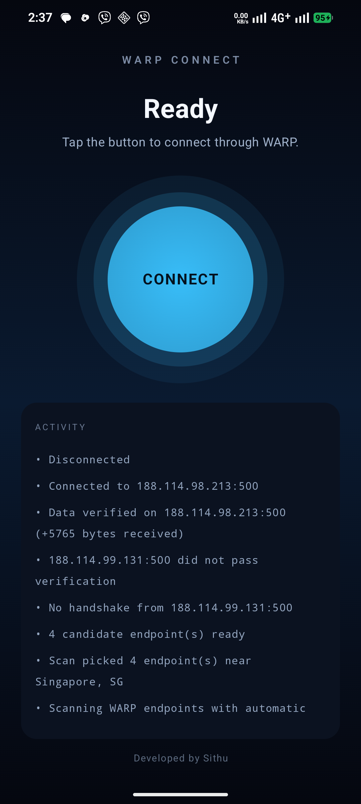
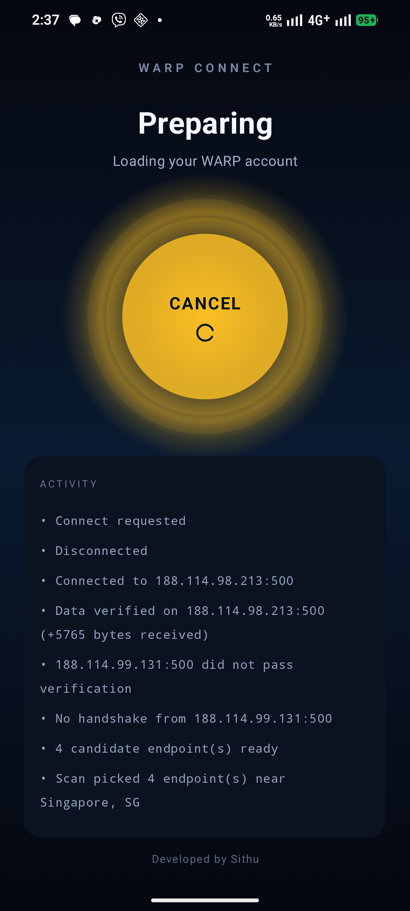
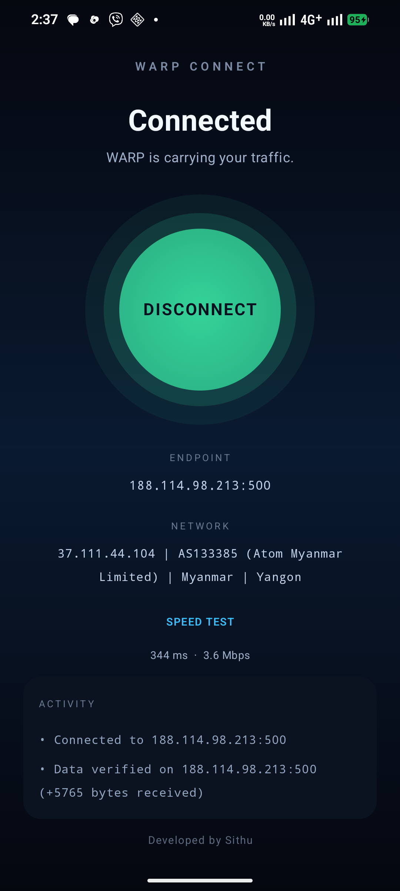

# WARP Connect

[](https://github.com/sithumht/warpconnect/releases/latest)
[](https://developer.android.com/about/versions/oreo)
[](./LICENSE)

[**မြန်မာဘာသာ လမ်းညွှန် (အင်တာနက် တပ်ဆင်နည်း၊ FAQ) →**](README.my.md)

A one-button Android app that connects to Cloudflare WARP and keeps itself
connected. No profile pickers, no endpoint lists, no DNS/route settings: tap
**CONNECT**, tap again to disconnect. Everything else is automatic.

## Download

The latest APK is on the [Releases](https://github.com/sithumht/warpconnect/releases/latest)
page — or on the **[WARP Connect website](https://site.vanzconnect.online/)**
(English / မြန်မာ). Sideload it (allow "Install unknown apps" for your browser or file
manager), or install it with `adb install -r warpconnect-vX.Y.Z.apk`. Android
8.0+, no root required. This build is distributed outside Google Play, so
updates come from the Releases page, not the store.

| | |
|---|---|
| **Application ID** | `com.warpconnect.app` |
| **Contents** | `arm64-v8a`, `armeabi-v7a`, `x86_64` |
| **Size** | ~48 MB |
| **Signing** | Release keystore — future updates must be rebuilt with the same key |

## Telegram bot

No browser, no account hunting: message **[@warpconnect_bot](https://t.me/warpconnect_bot)** and tap `/start` — it sends you the latest APK with the Burmese install guide inline (or `/apk`, `/sha`, `/help`). One shared link for Facebook and Telegram groups.

## Screenshots

Captured from a real ATOM Myanmar (41406) connection on a Pixel-class arm64 phone, app v1.0.1:

| Ready | Preparing | Connected · 344 ms · 3.6 Mbps |
|:-----:|:---------:|:----------------------------:|
|  |  |  |

The activity log shows what the app is doing — endpoint scan results, verification failures, data confirmed — so a connection that "won't come up" is never a silent one.

## Windows

A Windows desktop build is in active development. The Go engine already
cross-compiles to `windows/amd64` and the WinTUN bring-up is written, but it is
not part of any release yet.

The VPN engine is [warpscout](https://github.com/openwarpkit/warpscout-android)
(MIT), compiled into a single gomobile AAR. `amneziawg-go` runs inside that AAR
and receives the Android `VpnService` TUN file descriptor directly, so there is
no second native build and no root requirement.

## What happens when you tap CONNECT

1. **Account.** On first run the app registers a fresh WARP account, trying
   warpscout's registration paths one by one: direct Cloudflare API, two
   BaseRelay proxies (yours at `warpconnect-relay.netlify.app`, then the upstream
   `edge-client-api.vercel.app`), then a WARP tunnel built from warpscout's
   embedded bootstrap keys. Registration is a real HTTPS POST/PATCH, so a
   successful account also proves the path carried data. The account is then
   stored and reused forever; keys are never rotated.
2. **Network profile + cached winner.** The app keys saved endpoints to the
   network profile — Wi-Fi SSID (asks for location once), or the cell carrier
   name + MCC-MNC (asks for phone state once), falling back to
   iface/gateway/DNS if denied. On later runs the endpoints that carried
   traffic on this exact network (up to 3, 24 h TTL) are tried first; if one
   still handshakes and passes data the app connects in seconds without a scan.
3. **Scan.** Otherwise warpscout scans WARP endpoints with `protocol=awg` and
   automatic mimicry profiles (`AWGAutoI1` rotation: default, QUIC, DNS, SIP,
   legacy). It keeps only endpoints that answered 10 in-tunnel ICMP echoes to
   `1.1.1.1` *and* were still alive at the end of the test (durable), plus a few
   that worked but went quiet, as fallbacks.
4. **Deep search.** If nothing durable was found, `FindJunk` searches junk
   parameters (`jc/jmin/jmax`) and mimicry chains for up to 3 minutes, then a
   second scan is pinned to the winning profile. The same loop repeats if the
   scan called endpoints durable but every one of them still fails the two
   gates below, because that is what a DPI teardown looks like.
5. **Verify.** For each candidate, a `VpnService` interface is established, the
   TUN fd is handed to amneziawg-go, then the app requires:
   - a real WireGuard handshake (`last_handshake_time` set), and
   - a TCP connect to `1.1.1.1:443` that has to cross the tunnel (the app is not
     excluded from its own VPN), cross-checked with the tunnel's `rx_bytes`
     delta.

   An endpoint that fails either gate is torn down and the next candidate is
   tried.
6. **Stay connected.** Every 15 s the app repeats the liveness probe and checks
   the handshake age (capped at 300 s). Two consecutive failures trigger
   auto-heal: backoff 2/4/8 s, then reconnect (max 3 heals per hour). Heal is
   designed to be fast — it first retries the endpoints that already carried
   traffic on this network (last four per network, kept in a per-network
   history), then a reduced-effort "quick scan" (single sample per subnet,
   higher parallelism, 45 s hard deadline), and only as a last resort a full
   scan (without the 3-minute junk deep-search). If the device loses every
   non-VPN internet connection (Wi‑Fi and mobile data both off), a network
   watchdog stops the tunnel cleanly instead of healing against a dead
   network, and the UI says the VPN has been turned off. This is what handles
   "connects, then dies seconds later" DPI teardown.

Everything is fixed and non-configurable: AmneziaWG, full tunnel, Cloudflare DNS
(`1.1.1.1`/`1.0.0.1`), MTU 1280, IPv4 route plus the account's IPv6 address when
present. No MASQUE, no `vpn://` config, no `awgconfig.com` / Endpoint Lab data.

## Build

Requirements: JDK 17+, Android SDK with platform 37 and NDK 28.2.13676358,
Go 1.24+ with `gomobile` for rebuilding the engine.

The prebuilt AAR is already included at
`engine/android/app/libs/warpscout.aar`, so an app-only build needs no Go.

```powershell
# Optional: rebuild the gomobile AAR after changing Go code
$env:Path = "$env:LOCALAPPDATA\opencode-tools\go\bin;$env:USERPROFILE\go\bin;$env:Path"
$env:ANDROID_HOME = "$env:LOCALAPPDATA\Android\Sdk"
$env:ANDROID_SDK_ROOT = $env:ANDROID_HOME
powershell -ExecutionPolicy Bypass -File .\engine\scripts\build-mobile.ps1

# First-time only, forks and CI: if you do NOT have your own google-services.json
# (the real one is deliberately not in the repo — see .gitignore), copy the stub.
# The stub only proves the build links; it cannot talk to Firebase.
if (-not (Test-Path app/google-services.json)) {
  Copy-Item app/google-services.example.json app/google-services.json
}

# Build the app
.\gradlew.bat :app:assembleDebug --no-daemon
```

The APK is written to `app/build/outputs/apk/debug/app-debug.apk` and contains
`libgojni.so` for `arm64-v8a`, `armeabi-v7a` and `x86_64`.

Install it by sideloading the APK on the phone (or `adb install -r`). No PC is
needed at runtime.

## Verified on device

Tested end to end on an Android 16 / arm64 phone (no root, sideloaded debug APK):

- First run: account registered through the bootstrap tunnel, handshake and data
  gates passed, tunnel established. Device egress became Cloudflare WARP
  (`104.28.x.x`, `CF-RAY ...-SIN`), and `ping 1.1.1.1` worked through the tunnel.
- Reconnect from a cold process: the stored account and per-network winner were
  reused, connected in under 3 s.
- Wi-Fi outage: two failed health checks, teardown, automatic scan, then healed
  on a freshly scanned endpoint and resumed carrying traffic.
- Internet loss: Wi‑Fi and mobile data disabled with the tunnel up — a
  network watchdog stopped the VPN within seconds and the UI showed
  "Internet is offline — the VPN has been turned off".
- Disconnect and force-stop while connected: the TUN interface, foreground
  service and notification were all removed; no leaked interface or wake lock.

## Stats uplink

On every verified connection (initial connect *and* auto-heal) the app POSTs the
endpoint and the network profile that carried it to a Cloudflare Worker
(`warpconnect-stats`, backed by **D1**):

`POST https://stats.vanzconnect.online/report`

```json
{
  "endpoint": "8.39.125.76:500",
  "transport": "cell",
  "ssid": "",
  "carrier": "ATOM 4.5G",
  "mccmnc": "41406",
  "isp": "Atom Myanmar Limited",
  "asn": "AS133385",
  "asn_org": "Atom",
  "country": "Myanmar",
  "city": "Yangon",
  "ts": 1762948200
}
```

The app also sends a lightweight heartbeat (~every 60 s) while connected so
the dashboard can show an "Online now · live" panel — devices drop off the
list within ~90 s of losing the tunnel (or immediately on a clean disconnect,
via a `bye` signal).

The same host serves a password + TOTP gated dashboard (`/`) with:
- **Range filter pills** — `24h` / `7d` / `30d` / `all time`; every stat,
  aggregate table and the CSV export honour the selection.
- **Row-level CSV export** — each endpoint×profile row has a **CSV** button
  that downloads exactly that cohort (filtered by the row's top ISPs and ASNs
  and the current time range). Plain `/stats.csv` exports the range cohort.
- **Aggregate leaderboard** — endpoint × profile, counts, ISPs seen, ASNs seen.
- **Transport mix** donut, **Top endpoints** bar chart, recent-reports table.
- Device profile, ISP, ASN, country/city, first-seen timestamp online/offline.

**Auth** — `/login` requires `admin` + password + TOTP (authenticator app).
Set via `wrangler secret put STATS_{USER,SALT,HASH,PBKDF2_ITER,TOTP_SECRET,SESSION_KEY}`.

All data is stored in your own **D1 `warpconnect-stats`** database — no KV,
no third-party storage. SQL schema is applied automatically on first request
(`CREATE TABLE IF NOT EXISTS`).

## Requirements and limits

- Android 8.0+ (`minSdk 26`), no root.
- The app consumes only warpscout's engine; there is no fallback to another
  transport if a network blocks WARP itself.
- First-run registration tries direct Cloudflare API, two BaseRelay proxies
  (`warpconnect-relay.netlify.app`, then `edge-client-api.vercel.app`), then a
  WARP tunnel built from warpscout's embedded bootstrap keys (parallel endpoint
  sweep plus six random I1 mimicry variants per protocol profile). A few
  heavily filtered ISPs still kill every path; in that case register once on
  any Wi-Fi network — the resulting account is network-independent and works
  on cell afterwards.
- Networks that block every WARP endpoint, or that only allow protocols
  warpscout does not implement (e.g. MASQUE-only paths), cannot be bypassed. The
  app reports that honestly instead of showing a fake "connected" state.
- Registration and scanning need working outbound UDP. The first attempt on a
  heavily filtered network can take several minutes (registration, scan, deep
  search, and a second round if the first batch is torn down after connecting)
  before the tunnel comes up.
- The account is stored in app-private `SharedPreferences`. It is a throwaway
  WARP identity, not tied to your Cloudflare account.

## Attribution

- [warpscout](https://github.com/openwarpkit/warpscout-android) — MIT, the
  scanning / AmneziaWG engine vendored under `engine/`.
- [amneziawg-go](https://github.com/amnezia-vpn/amneziawg-go) — MIT, the
  userspace WireGuard/AmneziaWG implementation used by the engine.
- The embedded bootstrap keys and mimicry profiles come from warpscout.

## Developed by

Sithu ([@sithumht](https://github.com/sithumht))

See the [changelog](CHANGELOG.md) for release notes.


