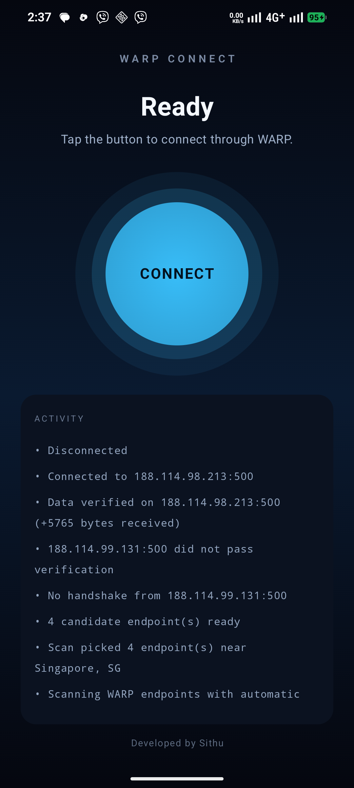
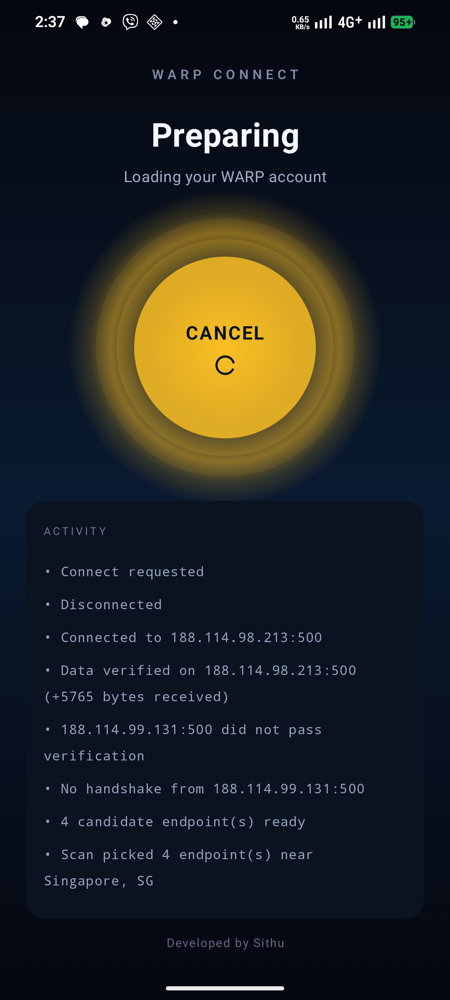
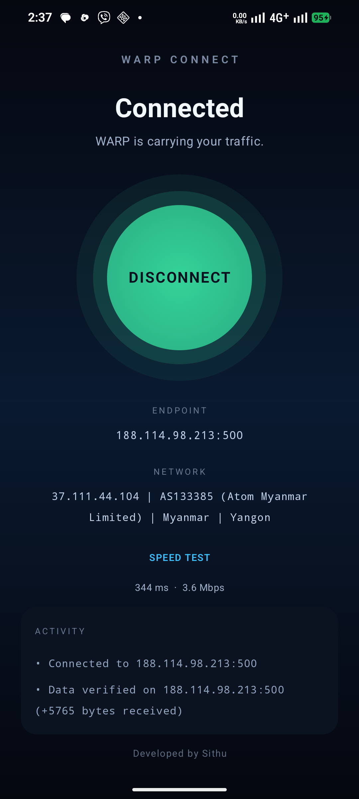

# WARP Connect (မြန်မာဘာသာ)

[English README](README.md) · [Releases](https://github.com/sithumht/warpconnect/releases)

Android ဖုန်းထဲမှာ Button တစ်ခုတည်းနှိပ်ရုံနဲ့ Cloudflare WARP VPN ကို ချိတ်ဆက်ပေးတဲ့ အက်ပ်ဖြစ်ပါတယ်။ အင်တာနက် block / filter လုပ်ထားတဲ့ network များ (ဥပမာ ATOM Myanmar) မှာ အင်တာနက်ကို ပြန်ဖွင့်ပေးနိုင်ဖို့ ရည်ရွယ်ပါတယ်။

ဖုန်းကို root လုပ်စရာမလိုပါဘူး။ အကောင့်ဖွင့်စရာ (account) မလိုပါဘူး။ Settings တွေကို ပြင်စရာမလိုပါဘူး။ **CONNECT** နှိပ်ရုံပါပဲ။

## ဒီအက်ပ်ကို ဘာကြောင့် သုံးရသလဲ

မြန်မာနိုင်ငံက network များ (ATOM, MPT, Ooredoo, Mytel) မှာ DPI (Deep Packet Inspection) နဲ့ အင်တာနက်ကို filter လုပ်ထားတတ်ပါတယ်။ အဲဒီအခါ Google, Facebook, YouTube, သတင်းဆောင်းသား site များကို ဖွင့်မရတာမျိုး ဖြစ်တတ်ပါတယ်။

WARP Connect က အဲ့ဒီလို network များပေါ်မှာလည်း ချိတ်ဆက်နိုင်အောင် အလုပ်လုပ်ပေးပါတယ်။

- တစ်ချိန်တည်းနဲ့ အလုပ်လုပ်နိုင်အောင် endpoint တွေကို အလိုအလျောက် ရှာဖွေ၊ စမ်းသပ်၊ ခိုင်ခံ့တဲ့ endpoint ကို ရွေးပေးတယ်
- အလုပ်လုပ်တဲ့ endpoint ရဲ့ အချက်အလက်ကို ကိုယ်သုံးနေတဲ့ network အလိုက် မှတ်ထားပြီး နောက်တစ်ခါ ချိန်မှ ချက်ခြင်း ချိတ်ဆက်ပေးတယ် (တောင်ထားတဲ့ endpoint က အလုပ်လုပ်ဆဲဆိုရင်)
- Tunnel ပြတ်ရင် အလိုအလျောက် ပြန်ချိတ်ဆက်ပေးတယ်
- အက်ပ်က "ချိတ်ဆက်နေပါတယ်" လို့ အတုမြင်ပြတာမဟုတ်ပါ — အတိအကျ ချိတ်ဆက်မိမှသာ အလုပ်လုပ်ပါတယ်

## Telegram bot

GitHub မလိုပါ။ **[@warpconnect_bot](https://t.me/warpconnect_bot)** ကို message ပေးပြီး `/start` နှိပ်ပါ — APK ကို မြန်မာဘာသာ လမ်းညွှန်နှင့်အတူ ပေးပို့ပါတယ်။ Facebook/Telegram မှာ မျှဝေဖို့ link တစ်ခုတည်း။

## လိုအပ်ချက်များ

- Android 8.0 အထက်ဆိုရင် ရပါတယ်
- Root မလိုပါဘူး
- ဖုန်းကို မည်သည့် app မှ download ပြုလုပ်ခွင့်ရရမည် (unknown apps permission)

## ဒီ app ကို ဘာလို့ ယုံရသလဲ

- **Open source**: ဒီ repo မှာ source code အားလုံး အခမဲ့ ကြည့်နိုင်ပါတယ်
- **Paid မဟုတ်ပါ**: အလကားပါ။ ads မရှိပါ
- **Google Play မှာမဟုတ်ပါ**: အပြင်ကနေ APK ကို download လုပ်ပြီး တပ်ဆင်ရတဲ့ ပုံစံပါ
- **ဖုန်းထဲက ဖတ်မရပါဘူး**: VPN က traffic ကို encrypt လုပ်ပေးရုံပါ။ photo, chat, password တွေကို မမြင်နိုင်ပါ
- **အချက်အလက်ပို့တာ**: ချိတ်ဆက်တိုင်း carrier (ATOM/MPT စသည်), ASN, city/country, endpoint — ဒါတွေကို သာ stats server ဆီ ပို့ပါတယ်။ သင့် browsing history, message, password ကို မပို့ပါဘူး။ Crash report ကောင်းမွန်ဖို့ Firebase Crashlytics/Analytics ကိုလည်း သုံးပါတယ်

## ထည့်သွင်းနည်း (Install နည်း)

1. [Releases](https://github.com/sithumht/warpconnect/releases) ကို သွားပါ
2. `warpconnect-v1.0.1.apk` ကို နှိပ်ပြီး download လုပ်ပါ
3. Download ပြီးသွားရင် `warpconnect-v1.0.1.apk` ကို နှိပ်ပါ
4. "Install unknown apps" ခွင့်ပြုဖို့ တောင်းခံလာပါက **Allow** / **ခွင့်ပြုပါ** ကို နှိပ်ပါ
5. Install ပြီးရင် app ကိုဖွင့်ပြီး **CONNECT** ကို နှိပ်ပါ
6. ပထမဆုံးအကြိမ် ချိတ်ဆက်မှု ၂ မိနစ်မှ ၅ မိနစ်လောက် ကြာနိုင်ပါတယ် (account ပြုလုပ်ခြင်း + endpoint ရှာဖွေခြင်း)။ နောက်ပိုင်းကတော့ စက္ကန့်ပိုင်းနဲ့ ချိတ်ဆက်နိုင်ပါတယ်

### Play Protect ဆိုပြီး သတိပေးလာရင်

Google Play Store ကနေ download မဟုတ်တဲ့ APK တွေကို Play Protect က သတိပေးတတ်ပါတယ်။ ဒါက ပုံမှန်ပါ — ဒီ app ကို Google Play မှာ မတင်ထားလို့ပါ။

- **"More details"** ကို နှိပ်ပါ
- **"Install anyway"** ကို နှိပ်ပါ

ဒါက APK ကို install လုပ်ဖို့ လုံခြုံသည့် certificate ထည့်ထားတဲ့သောကြောင့် ဖြစ်ပါတယ်။

### SHA-256 (optional)

လုံခြုံမှုကို ပိုစိတ်ပူသူများအတွက်:

```
SHA-256: 2e615a7e7c6681025cb8e9b50b14c8d08c080c6cdc8735afd3df3ebda946f827
```

SHA-256 ကို Windows မှာ ဒီလိုစစ်နိုင်ပါတယ်:

```powershell
Get-FileHash warpconnect-v1.0.1.apk
```

## ချိတ်ဆက်နေတာကို ဘယ်လိုသိမလဲ

- ခလုတ်ပေါ်မှာ **DISCONNECT** လို့ ပြပါမယ် (အစိမ်းရောင်)
- **ENDPOINT** အောက်မှာ IP:port ပေါ်ပါမယ် (ဥပမာ `188.114.98.213:500`)
- **NETWORK** အောက်မှာ သင့် carrier, အစိုးရနိုင်ငံ, မြို့ ပေါ်ပါမယ် (ဥပမာ `ATOM Myanmar Limited | Myanmar | Yangon`)
- **SPEED TEST** နှိပ်ရင် latency နဲ့ speed တွေ ပြပါမယ်
- **ACTIVITY** နေရာမှာ "Connected to ...", "Data verified on ..." စတဲ့ log တွေ မြင်ရပါမယ်

## ပြဿနာများ ဖြေရှင်းနည်း

**CONNECT နှိပ်လိုက်တာ မချိတ်ဆက်ဘူး**

- network ပေါ်မူတည်ပါတယ်။ ချိတ်မရသေးလည်း တစ်မိနစ်လောက် စောင့်ပြီး ထပ်နှိပ်ပါ
- Wi-Fi ပေါ်မှ ချိတ်ဆက်ရုံနဲ့ cellular network ပေါ် ချိတ်ဆက်ရပါတယ် (account က network မရွေးပါဘူး)
- ATOM မှာ endpoint တွေ ၂-၃ ရက်တစ်ခါ ပြောင်းနေတတ်ပါတယ် — အက်ပ်က အလိုအလျောက် ရှာပေးပါတယ်

**ချိတ်ဆက်ပြီး ခဏနေရင် ပြတ်တတ်တယ်**

- အက်ပ်က ၁၅ စက္ကန့်တစ်ခါ စစ်ဆေးပြီး ပြတ်ရင် အလိုအလျောက် ပြန်ချိတ်ဆက်ပေးပါတယ်
- လိုင်းက လုံးဝပြတ်ရင် အက်ပ်က VPN ကို ပိတ်ပေးပြီး "Internet is offline" လို့ ပြပါမယ်

**Speed နှေးတယ်**

- Myanmar ရဲ့ international bandwidth က အမြဲတမ်းဆိုသလို နိမ့်ပါတယ်။ WARP က security ပေးပေမယ့် speed က service provider ပေါ်မူတည်ပါတယ်

**Battery ပိုကုန်တယ်**

- VPN tunnel ဖွင့်ထားတိုက်မှာပဲ traffic အားလုံး tunnel ထဲက ဖြတ်ပြီး encrypt လုပ်ရတဲ့အတွက် နည်းနည်း ပိုသုံးပါတယ်။ ပိတ်ထားချိန်မှာ မသုံးတဲ့အတွက် ပုံမှန်ပါပဲ

**ဘယ်လို update လုပ်ရမလဲ**

- Releases page မှ APK အသစ်ကို download ပြီး အဟောင်းပေါ်မှာတင်တင် ထပ်ပြီး install လုပ်ပါ (signature တူလို့ install ရပါတယ်)

## ကန့်သတ်ချက်များ (သိထားရန်)

- အက်ပ်က WARP endpoint အားလုံးကို block လုပ်ထားတဲ့ network များမှာ ချိတ်ဆက်မရပါဘူး
- ပထမဆုံးအကြိမ် ချိတ်ဆက်မှု ၅ မိနစ်လောက် ကြာနိုင်ပါတယ်
- Windows version မပါသေးပါဘူး (ဖွံ့ဖြိုးဆဲပါ)
- အင်တာနက် traffic အားလုံးကို VPN tunnel ထဲကဖြတ်ပါတယ် — လျင်မြန်မှု ပြောင်းလဲနိုင်ပါတယ်

## Screenshot များ

| Ready (မချိတ်ဆက်ရသေး) | Preparing | ချိတ်ဆက်ပြီး 344 ms · 3.6 Mbps |
|:-----:|:---------:|:-----:|
|  |  |  |

## အကူအညီလိုရင်

GitHub Issues မှာ မေးနိုင်ပါတယ်: <https://github.com/sithumht/warpconnect/issues>

Report လုပ်တဲ့အခါ — ဖုန်း model, Android ဗားရှင်း, network အမျိုးအစား (ATOM/MPT/Ooredoo/Mytel), CONNECT နှိပ်ပြီး ACTIVITY log ပေါ်ပြတဲ့ error ကို ထည့်ပေးပါ။

## Credits

- [warpscout](https://github.com/openwarpkit/warpscout-android) — VPN engine (MIT)
- [amneziawg-go](https://github.com/amnezia-vpn/amneziawg-go) — userspace WireGuard/AmneziaWG implementation (MIT)
- Developed by **Sithu ([@sithumht](https://github.com/sithumht))**
